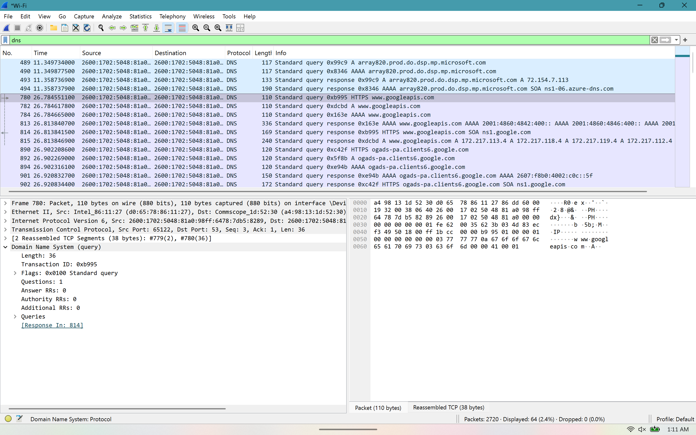
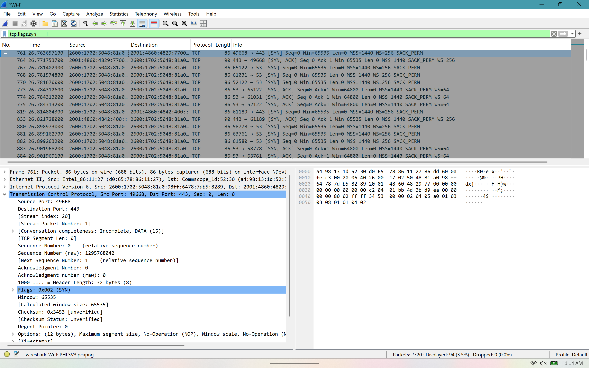
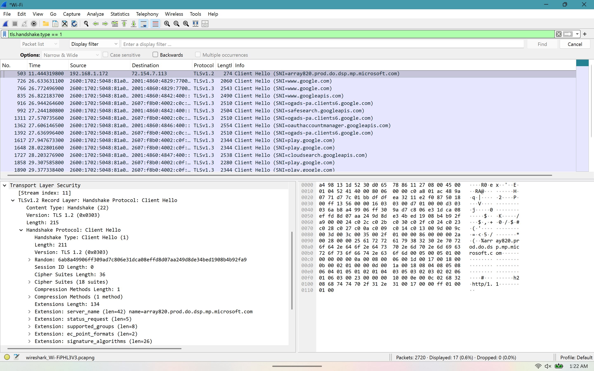

# Network Traffic Investigation

## Overview

This project is a hands-on network traffic investigation using Wireshark. I captured and analyzed network traffic from my own system to better understand how common network protocols appear during normal network activity.

The investigation focuses on DNS queries, TCP connection establishment, and TLS encrypted communication.

## Tools Used

- Wireshark
- Windows
- Google Chrome
- TCP/IP

## DNS Traffic Analysis

I used the `dns` display filter in Wireshark to isolate DNS traffic generated while browsing the web.

During the analysis, I observed DNS queries and responses used to resolve domain names to IP addresses. I also examined the source and destination addresses and the information contained within DNS packets.

### Findings

- Identified DNS queries and responses
- Observed domain name resolution
- Examined source and destination addresses
- Identified A and AAAA DNS records

## TCP Connection Analysis

I filtered TCP traffic using:

`tcp.flags.syn == 1`

This allowed me to identify packets involved in initiating TCP connections. I examined a SYN packet sent to destination port 443, which is commonly used for HTTPS traffic.

### Findings

- Identified TCP SYN packets
- Examined source and destination ports
- Observed a connection being initiated to port 443
- Reviewed TCP sequence numbers and flags

## TLS Analysis

I used the following Wireshark filter to identify TLS Client Hello packets:

`tls.handshake.type == 1`

I examined a Client Hello packet and reviewed information used during the TLS handshake, including the TLS version, cipher suites, and extensions.

### Findings

- Identified TLS Client Hello packets
- Observed TLS 1.2 and TLS 1.3 traffic
- Examined supported cipher suites
- Reviewed TLS extensions and server name information
- Observed the beginning of encrypted HTTPS communication

## Skills Demonstrated

- Network traffic analysis
- Packet inspection
- Wireshark display filtering
- DNS analysis
- TCP/IP
- TCP connection analysis
- TLS traffic analysis
- Network troubleshooting
- Cybersecurity investigation

## Conclusion

This project helped me gain hands-on experience analyzing network communications with Wireshark. By examining DNS, TCP, and TLS traffic, I was able to better understand how devices resolve domain names, establish network connections, and begin encrypted communication.

## Disclaimer

All network traffic analyzed in this project was captured from my own authorized environment for educational and cybersecurity learning purposes.
